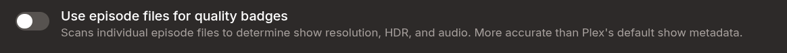
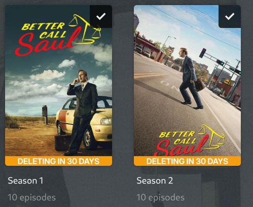
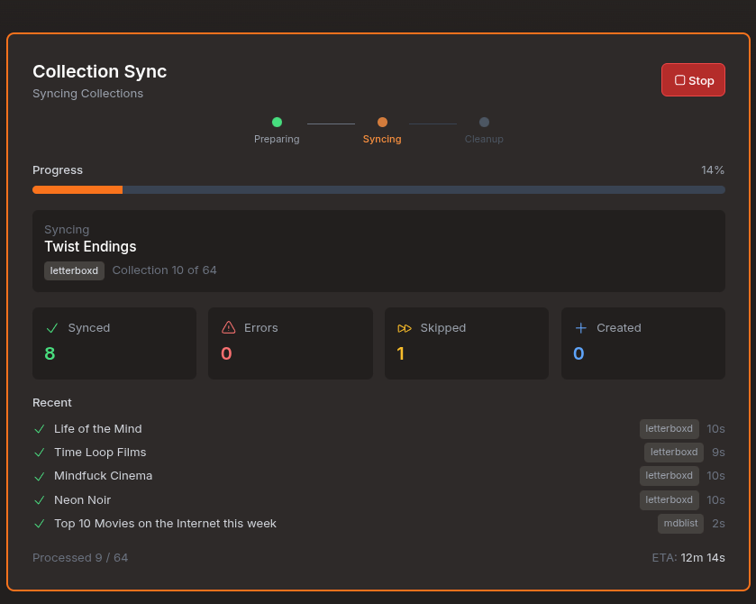

# Agregarr (bitr8 fork)

[](https://github.com/bitr8/agregarr-dev/releases/latest) [](https://hub.docker.com/r/bitr8/agregarr) [](LICENSE)

Agregarr builds Plex collections from lists (TMDB, IMDb, Letterboxd, MDBList, Trakt, AniList, and your own Plex labels), draws overlays onto posters, and creates Coming Soon placeholders for titles you don't have yet.

Upstream [Agregarr](https://github.com/agregarr/agregarr) has been quiet since April 2026. This fork continues the work, with fixes, new features, and a release every few weeks. It's maintained by an upstream contributor with [46 merged PRs](https://github.com/agregarr/agregarr/pulls?q=is%3Apr+is%3Amerged+author%3Abitr8) there. Docker releases ship as `bitr8/agregarr`.

Each version's changes are in the [release notes](https://github.com/bitr8/agregarr-dev/releases).

> [!WARNING]
>
> **Still running `agregarr/agregarr`? Switch to this image.** Upstream's `:latest` (v2.4.2, March 2026) includes `youtube-search-without-api-key`, a package npm pulled and flagged as malicious ([MAL-2026-18270](https://osv.dev/vulnerability/MAL-2026-18270)), and runs on Node 20. Releases from this fork remove that package and include the Node, Express, axios, sharp, and Next.js security updates. See [v2.12.1](https://github.com/bitr8/agregarr-dev/releases/tag/v2.12.1) and [v2.12.3](https://github.com/bitr8/agregarr-dev/releases/tag/v2.12.3).

> [!IMPORTANT]
>
> **Agregarr supports Plex Media Server 1.43.3.10861 and newer.** Older builds contain actively exploited security vulnerabilities (CISA KEV: CVE-2026-96652, CVE-2026-96654, CVE-2026-96655, CVE-2026-96656), so the Plex Version health check turns red on them. TV edition placeholders need 1.43.3 or newer and stay off below it. See [Plex's security notice](https://forums.plex.tv/t/important-security-update-for-plex-media-server-v1-43-2-and-earlier/942319).

## Docker

| Tag              | What it tracks                                             |
| ---------------- | ---------------------------------------------------------- |
| `:latest`        | Stable releases. Recommended for most users.               |
| `:2.12.3` (etc.) | Pinned to a specific release.                              |
| `:develop`       | Bleeding edge. Builds on every push to develop, may break. |

Release tags support amd64 and arm64 (Apple Silicon, RPi 4+). The `:develop` tag is amd64 only.

**Switching from upstream?** Stop Agregarr and back up your config folder first. Then change the image line in your compose file. The fork reads upstream's config but adds its own database migrations, so going back means restoring that backup.

```diff
-    image: agregarr/agregarr:latest
+    image: bitr8/agregarr:latest
```

### Compose example

```yaml
services:
  agregarr:
    image: bitr8/agregarr:latest
    container_name: agregarr
    volumes:
      - /path/to/config:/app/config
      - /path/to/placeholder/movies:/data/movies # Optional: Coming Soon
      - /path/to/placeholder/tv:/data/tv # Optional: Coming Soon
    environment:
      - TZ=Australia/Sydney
      - PUID=1000 # Your host user ID (run `id -u`)
      - PGID=1000 # Your host group ID (run `id -g`)
      - UMASK=022
    ports:
      - 7171:7171
    restart: unless-stopped
```

Swap in your own paths, run `docker compose up -d`, then open `http://YOUR_HOST:7171` and sign in with Plex.

> [!WARNING]
>
> **File permissions:** Set `PUID` and `PGID` to the user that owns your media directories. Without them, the container runs as root and may create directories with restrictive permissions, which can break imports in Sonarr, Radarr, and other apps. On Unraid, use `PUID=99` and `PGID=100`.

The [upstream docs](https://agregarr.org/docs/installation) still apply for general configuration, including services, collections, and overlays.

### Cloudflare solver

FlixPatrol sits behind Cloudflare, so its collections (Networks Top 10 and streaming charts) need a solver. You can use FlareSolverr, [Byparr](https://github.com/ThePhaseless/Byparr), or both.

The image includes headless Chromium as a fallback, but a dedicated solver tends to be far more reliable.

```yaml
  flaresolverr:
    image: ghcr.io/flaresolverr/flaresolverr:latest
    container_name: flaresolverr
    environment:
      - LOG_LEVEL=info
    restart: unless-stopped
```

Add the solver under **Settings > Sources > Cloudflare Solvers**, for example `http://flaresolverr:8191`. More than one can be listed. Fetches try them in priority order, and an instance that breaks is backed off for that domain rather than blocking the rest.

If the log shows `solver loaded flixpatrol.com but the site returned HTTP 403`, it looks like Cloudflare has blocked your IP. Run a second solver through a proxy or VPN container, then add it below the main one. FlareSolverr reads `PROXY_URL`, while Byparr reads `PROXY_SERVER`.

## What it does

### Collections

Pick a source and a library, then Agregarr keeps the Plex collection in step with it. Presets fill out the form for the common ones.

Beyond list sources:

- **Library essentials** uses one config to generate a smart collection for each genre, decade, resolution, or content rating. An optional separator collection can group them.
- The **Plex Label** source builds a collection from items carrying a label. **Target User** hides that collection from everyone except one Plex user.
- **Filtered Plex hubs** replace Recently Added, Recently Released, and Recently Released Episodes with versions that leave placeholders out.
- **Sort Title** pins a collection's place in Plex's alphabetical order. **Exclude from Ordering (Plex Label)** under Settings > General leaves collections managed by Shortlist or Kometa alone.
- Multi-source collections get an **Item Order**, so the Max Items cut keeps the best of each list. **Minimum IMDb votes** stops auto-download chasing a high rating based on a handful of votes.
- IMDb charts include the Top 250 and Bottom 100.
- Collection configs export to JSON and can be imported on the same instance or another one.

Agregarr recognises its own collections by label, so a hand-made collection with the same name isn't mistaken for one of them.

### Overlays

The template editor supports per-element conditions, so an element only renders when a field matches. It also has colour scaling on tiles and a configurable canvas size.

Presets cover the usual badges. There's also an opt-in **Audio Codec** preset that reads the streams Plex scanned, including TrueHD Atmos, DD+ Atmos, DTS-HD MA, and others. Movies only for now.

Per-library **episode media scanning** reads the actual episode files for resolution and HDR badges instead of relying on show-level metadata.



Next-episode countdowns come from Sonarr, and templates can distinguish an estimated release date from a published one.

With Maintainerr connected, season posters show a deletion countdown drawn with your own template. A per-library option also puts the countdown on the show poster once every season is scheduled to go.



**Parallel Items** under Settings > General can run up to 10 overlay items at once. The default is 1. The dashboard shows live progress and stats for collection and overlay syncs, with a stop button that cancels a run midway through.



Posterizarr can hand items back to Agregarr after an \*arr import, which updates overlays and collection membership without a full sync. It's off by default. See the [Posterizarr integration guide](POSTERIZARR.md).

### Coming Soon placeholders

Placeholders are small video files that put upcoming titles into Plex before you have them.

Trailers come from TMDB first, then a yt-dlp YouTube search. You can also skip the download and use the static placeholder video. Before creating one, Agregarr checks the Sonarr and Radarr download status and names folders to match.

Movie folders can include the TMDB ID (`Title (Year) {tmdb-12345}`), which keeps two films with the same title and year apart. Cleanup is self-healing: filters apply retroactively, and stuck records are cleared so the next sync can recreate them.

**Running Seerr too?** Seerr reads Plex for availability, and a placeholder looks like the real film, so requests get marked available.

[Rubeanie](https://github.com/Rubeanie) maintains a Seerr build (`rubeanie/seerr:ignore-media-regex`, upstream PR [seerr-team/seerr#2606](https://github.com/seerr-team/seerr/pull/2606)) that skips files matching a regex. Tick **Keep placeholder ignore patterns in Seerr** in Agregarr's Seerr settings. Agregarr writes the two patterns and checks them again at the start of every sync. The Health panel warns if they go missing.

### Health checks

Eighteen checks run on a schedule and appear under **Settings > About**. They cover service connections, the Plex version, Cloudflare solver, Seerr patterns, orphaned collection keys, template references, appdata and placeholder volumes, timezone, and job freshness.

External checks get a grace window. One transient failure shows as a warning rather than an error. Any check can be muted when it doesn't apply to your setup.

### Speed on big libraries

IMDb ratings are prefetched in batches. Caches expire based on the age of the content, TMDB lookups persist in SQLite, and Letterboxd pages are fetched over plain HTTP instead of through a headless browser.

## Relationship to upstream

This fork wouldn't exist without upstream [Agregarr](https://github.com/agregarr/agregarr).

It remains GPL-3.0 and reads upstream's config, so switching over is an image swap (see the backup note under Docker).

Fixes that fit upstream have been [offered back as PRs](https://github.com/agregarr/agregarr/pulls?q=is%3Apr+author%3Abitr8).

## Support

Bugs, feature requests, and new source requests go through [GitHub issues](https://github.com/bitr8/agregarr-dev/issues/new/choose).

Include the version shown under Settings > About and the relevant lines from `config/logs/agregarr-YYYY-MM-DD.log`. Fixes land on `develop` and ship in the next release. Older releases don't get backports.

Found something exploitable? Use the private route in [SECURITY.md](SECURITY.md), not a public issue.

## Contributing

PRs are welcome. Read [CONTRIBUTING.md](CONTRIBUTING.md) first: agree on scope in an issue, keep the PR to one concern, and run it against a real Plex.

## Licence

GPL-3.0, same as upstream.

## Credits

Built on [Agregarr](https://github.com/agregarr/agregarr).

Thanks to [Damienlee69](https://github.com/Damienlee69) (label collections), [Bergasha](https://github.com/Bergasha) (season count template variables), [Marcus Isdahl](https://github.com/marcusisdahl) (Posterizarr integration), [Rubeanie](https://github.com/Rubeanie) (show-poster countdown and the Seerr build), [gh0st-runner](https://github.com/gh0st-runner) (dynamic title prefix), and [diblaze](https://github.com/diblaze) (the yt-dlp trailer search approach).
